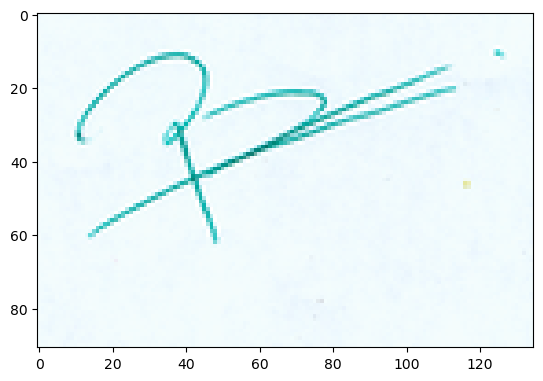
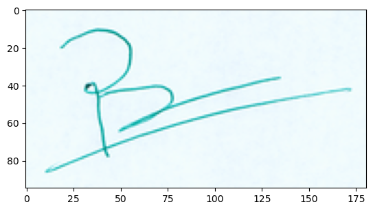
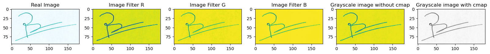
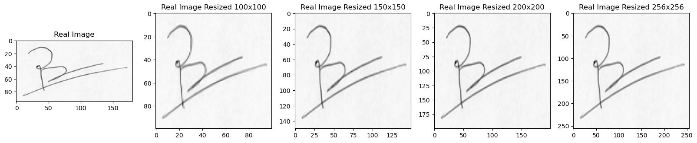
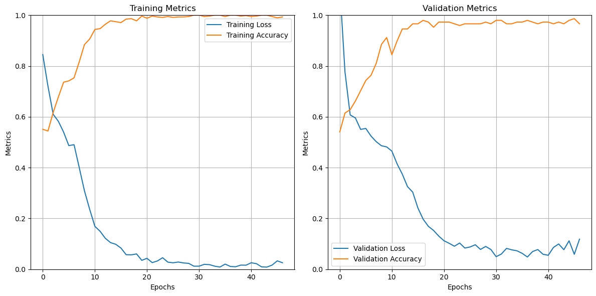
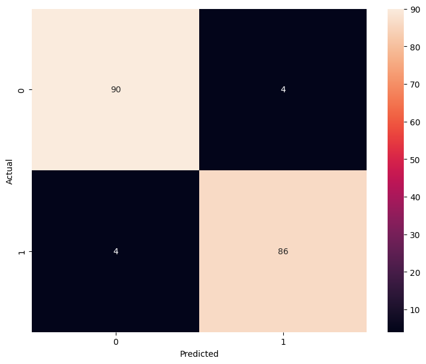

# Handwritten Signature Forgery Detection Using CNN

A Deep Learning and Computer Vision project that identifies genuine and forged handwritten signatures using a Convolutional Neural Network (CNN).

**Project Domain:** Deep Learning | Computer Vision | Image Classification

**Institution:** Vellore Institute of Technology (VIT), India

**Programming Language:** Python

---

## 1. Project Overview

Handwritten signatures are widely used for identity verification and authentication. However, forged signatures can create security and verification challenges.

This project explores an automated approach to handwritten signature forgery detection using image processing and deep learning.

The system uses a Convolutional Neural Network (CNN) to analyze signature images and classify them into two categories:

- **Genuine:** Authentic handwritten signatures.
- **Forged:** Imitated or forged handwritten signatures.

The project involves dataset collection, exploratory data analysis, image preprocessing, data augmentation, CNN model development, model training and performance evaluation.

## 2. Key Features

- **Signature Image Processing:** Loads and processes handwritten signature images.
- **Exploratory Data Analysis:** Examines signature datasets and compares image characteristics.
- **Image Preprocessing:** Converts images to grayscale and resizes them to 256 × 256 pixels.
- **Data Normalization:** Scales pixel values by dividing by 255.
- **Data Augmentation:** Applies rotation, width and height shifting, brightness adjustment and zoom.
- **CNN Architecture:** Implements a Sequential CNN model for binary image classification.
- **Model Optimization:** Uses Dropout, Batch Normalization and Early Stopping.
- **Performance Evaluation:** Evaluates predictions using a confusion matrix and classification report.

## 3. Dataset Description

The project uses genuine and forged handwritten signature images collected from multiple dataset directories.

The notebook combines signature image collections and assigns binary labels:

| Class | Label | Description |
|---|---:|---|
| Genuine | 0 | Authentic signature |
| Forged | 1 | Forged signature |

The collected dataset contains **930 signature images**.

### Dataset Examples



*Example of a genuine handwritten signature.*



*Example of a forged handwritten signature.*

## 4. Image Preprocessing and Exploratory Data Analysis

The notebook performs exploratory analysis to understand image characteristics and prepare the data for model training.

The preprocessing pipeline includes:

1. Loading signature images from the dataset directories.
2. Converting images into grayscale.
3. Resizing images to 256 × 256 pixels.
4. Replicating the grayscale channel to create three-channel image arrays.
5. Assigning binary labels to genuine and forged signatures.
6. Normalizing image pixel values to the range [0, 1].
7. Splitting the dataset into training, validation and testing subsets.

### Image Channel Comparison



### Image Size Comparison



### Data Splitting

The notebook uses `train_test_split` with a fixed random state of 26.

| Dataset | Number of Images |
|---|---:|
| Training | 588 |
| Validation | 148 |
| Testing | 184 |
| **Total** | **920** |

The remaining 10 images are separated for inference.

## 5. Data Augmentation

To introduce variations in training images, the project uses TensorFlow Keras `ImageDataGenerator`.

The training augmentation configuration includes:

- Rotation range: 30 degrees
- Width shift range: 0.2
- Height shift range: 0.2
- Brightness range: 0.4–1.5
- Zoom range: 0.3
- Fill mode: Nearest

Validation and test images use pixel rescaling without the training augmentation transformations.

## 6. CNN Model Architecture

The project implements a Sequential Convolutional Neural Network using TensorFlow and Keras.

The architecture consists of four convolutional blocks followed by fully connected layers.

### Architecture Components

| Layer | Configuration |
|---|---|
| Input | 256 × 256 × 3 |
| Conv2D | 16 filters, 3 × 3, ReLU |
| MaxPooling2D | 3 × 3 |
| Dropout | 0.25 |
| Conv2D | 32 filters, 3 × 3, ReLU |
| MaxPooling2D | 2 × 2 |
| Dropout | 0.25 |
| Conv2D | 64 filters, 3 × 3, ReLU |
| MaxPooling2D | 2 × 2 |
| Dropout | 0.25 |
| Conv2D | 128 filters, 3 × 3, ReLU |
| MaxPooling2D | 2 × 2 |
| Dropout | 0.25 |
| Flatten | Feature vector |
| Dense | 128 neurons, ReLU |
| Batch Normalization | Applied |
| Dropout | 0.25 |
| Output | 1 neuron, Sigmoid |

**Model Configuration:**
- Optimizer: Adam
- Loss Function: Binary Crossentropy
- Evaluation Metric: Accuracy
- Early Stopping: Monitors validation loss with patience of 10 epochs and restores the best weights.

The model contains approximately 1.15 million parameters.

## 7. Model Training and Evaluation

The CNN model is trained using the training dataset and monitored using validation data.

The notebook evaluates the trained model on the held-out test dataset using:
- Confusion Matrix
- Precision
- Recall
- F1-Score
- Accuracy

### Training and Validation Metrics



### Confusion Matrix



### Classification Report

The recorded classification report shows the following results:

| Metric | Class 0 | Class 1 |
|---|---:|---:|
| Precision | 0.96 | 0.96 |
| Recall | 0.96 | 0.96 |
| F1-Score | 0.96 | 0.96 |

<details>
<summary>Overall Evaluation Results</summary>

| Metric | Result |
|---|---:|
| Test Accuracy | **96%** |
| Macro Average F1-Score | 0.96 |
| Weighted Average F1-Score | 0.96 |
| Test Samples | 184 |

</details>

The model achieved a recorded test accuracy of **96%** on the held-out test dataset.

## 8. Technology Stack

| Category | Technologies |
|---|---|
| Programming Language | Python |
| Deep Learning Framework | TensorFlow, Keras |
| Image Processing | OpenCV, PIL |
| Data Processing | NumPy, Pandas |
| Data Visualization | Matplotlib, Seaborn |
| Machine Learning Utilities | Scikit-learn |
| Model Architecture | Convolutional Neural Network |
| Development Environment | Jupyter Notebook / Google Colab |

## 9. Repository Structure

```text
HANDWRITTEN-SIGNATURE-FORGERY-DETECTION-USING-CNN/
│
├── Handwritten_Signature_Forgery_Detection.ipynb
├── README.md
├── requirements.txt
├── .gitignore
│
└── screenshots/
    │
    ├── genuine-signature-example.png
    ├── forged-signature-example.png
    ├── image-channel-comparison.png
    ├── image-size-comparison.png
    ├── training-validation-metrics.png
    └── confusion-matrix.png
```

## 10. Getting Started

### Prerequisites

- Python 3.9 or compatible version
- Jupyter Notebook or Google Colab
- Required Python libraries listed in `requirements.txt`
- Signature image dataset used by the notebook

### Step 1: Clone the Repository

```bash
git clone https://github.com/jewelreddys/HANDWRITTEN-SIGNATURE-FORGERY-DETECTION-USING-CNN.git
```

### Step 2: Navigate to the Project

```bash
cd HANDWRITTEN-SIGNATURE-FORGERY-DETECTION-USING-CNN
```

### Step 3: Create a Virtual Environment

```bash
python -m venv .venv
```

Activate it on Windows:

```bash
.venv\Scripts\activate
```

### Step 4: Install Dependencies

```bash
pip install -r requirements.txt
```

### Step 5: Run the Notebook

```bash
jupyter notebook
```

Open `Handwritten_Signature_Forgery_Detection.ipynb` and execute the notebook cells.

**Note:** The original notebook uses local dataset directory paths. Download and organize the required signature datasets and update those paths to match your environment before running the notebook.

## 11. Future Enhancements

Potential improvements include:

- Developing a user-friendly interface for uploading signature images.
- Supporting real-time signature verification.
- Experimenting with transfer learning and advanced CNN architectures.
- Improving generalization using larger and more diverse signature datasets.
- Exploring Siamese Networks for writer-independent signature verification.
- Deploying the model as a web-based verification application.

These are potential enhancements and are not claimed as completed implementations.

## 12. Author

**S. Jewel Reddy**

Integrated M.Tech – Computer Science (Data Science)

Vellore Institute of Technology (VIT), India

[GitHub Profile](https://github.com/jewelreddys)

---

*This repository presents an academic deep learning project demonstrating image preprocessing, CNN-based binary classification and model evaluation for handwritten signature forgery detection.*
